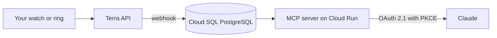

> **TL;DR:** Pace pulls your Garmin, Oura, Whoop, Polar or Apple Health data into a PostgreSQL database and exposes it to Claude as a custom connector. You connect the devices once through Terra, authorize Pace in Claude over OAuth 2.1, then ask about sleep, resting heart rate and training load in plain language. The free tier covers one device with 30 days of history, Pro costs €9 a month, and health data stays in the GCP europe-west1 region with explicit consent under GDPR article 9.

## What it is

Anton Salcher built Pace because he wanted to look at his own training in Claude and was tired of the dashboards his watch apps gave him. He posted it on Hacker News in April 2026 as an MCP server that connects wearables to Claude, and it is now a small hosted service with a free tier and a paid plan.

It is not an app you open. Pace sits between your devices and Claude as a connector. You create an account at pace-mcp.web.app, connect your wearables through a Terra widget, pick which data types to sync, then add Pace as a custom connector in Claude. After that the conversation happens in Claude, not in a Pace interface.

The service runs in English and German, and the company is registered in Carinthia, Austria.

| Component | What it does |
|---|---|
| Terra | Third-party aggregation service that pulls raw data from each vendor and normalizes it |
| Cloud SQL for PostgreSQL | Holds the synced records in one unified schema |
| Cloud Run | Serverless host for the MCP server, built with FastMCP and FastAPI in Python |
| Firebase Authentication | Sign-in by email and password, or Google SSO |
| Claude connector | The remote MCP endpoint Claude calls with your OAuth token |

## Why it matters

The numbers your watch produces are not the problem. A Garmin or an Oura ring already tracks deep sleep, HRV, resting heart rate and training load. What they do not do is tell you what those numbers mean for you this week, after the training block you just finished. The vendor app shows a chart. It does not answer the question.

Pace adds that interpretation layer, and it does it inside a model you may already pay for. Because it is an MCP server, the same data works across Claude on the web, Claude Desktop, Claude Code and the API through the MCP Connector, so the questions can be asked in the middle of other work rather than in a separate tool.

The second thing worth knowing is where the data comes from. Terra is the layer that talks to Garmin, Oura, Whoop and Polar, which is how Pace can claim 50 plus device types without writing 50 integrations of its own. It also means one aggregator sits between your health data and Claude, which has consequences for the privacy conversation below.

## Getting it running

1. Create a Pace account at pace-mcp.web.app. Email and password, or Google SSO.
2. Connect your wearables with the Terra widget and select which data types to sync.
3. In Claude, open Customize, then Connectors, then Add, pick Custom and Web, and paste the Pace URL.
4. Authorize Pace. The OAuth 2.1 handshake with PKCE runs in the browser and Claude stores the resulting token.
5. Ask something about your data.

The endpoint Pace publishes for that step is a plain Cloud Run URL, and it is a regular remote MCP server. Clients that read a standard MCP server list can point at the same address:

```json
{
  "mcpServers": {
    "pace": {
      "url": "https://pace-mcp-p7s6y4fxpa-ew.a.run.app/mcp"
    }
  }
}
```

Once it is connected, the questions Pace advertises look like this:

```text
How was my sleep last night compared to last week?
My resting heart rate has been elevated for two weeks. When did that start?
Am I recovered enough for an intense workout today?
Analyze my training load from the past two weeks.
```

## How the data moves



Onboarding is step one of the pipeline. Terra pushes device data into Pace's Cloud SQL instance by webhook, and Pace normalizes it into a shared schema so a Garmin sleep record and an Oura sleep record land in the same table. Multiple devices can be connected at once.

Claude then queries that database through Pace's MCP tools and answers in the conversation. The Python service on Cloud Run is the only part that talks to your data, and the Cloud SQL instance holds the history that the free tier then limits you to.

Two operational details came out of the Hacker News thread rather than the documentation. The founder described storing raw records in Postgres JSONB on top of the Terra aggregation layer, and other participants raised the Garmin Connect API rate limit of roughly 25 requests every 15 minutes, plus the cost of running a 90-day sleep query against that data. Both are the kind of thing that shows up in daily use rather than in a demo, so expect the first long-range question to be the slow one.

## Pricing

| Plan | Price | Devices | History | Backfill |
|---|---|---|---|---|
| Starter | €0 per month | one wearable | 30 days | 7 days |
| Pro | €9 per month | as many as you want | full history | 30 days |
| Coach | not available yet | up to 10 athletes | everything in Pro | 30 days |

Paying yearly is 20% cheaper than monthly.

## What to watch for

Health data is the category GDPR treats differently, and Pace's privacy policy is unusually explicit about it. Wearable metrics are collected only after you give explicit consent during onboarding, on the basis of article 9(2)(a) for special categories, and that consent can be withdrawn at any time. The server runs in europe-west1, which is St. Ghislain in Belgium. Terra acts as a processor with its own infrastructure in eu-west-2, AWS in the United Kingdom. Account data is deleted within 30 days of an account deletion request.

The part to think hardest about is where your health data ends up. Pace's policy says wearable and health data is processed to deliver personalized training and health analysis inside the Claude environment, so once you authorize the connector your sleep, heart rate and training records are part of what Claude receives. That is the point of the product, and it is also the reason to read the policy before you connect a device rather than afterwards.

Two smaller limits are worth knowing. The free plan connects a single wearable and keeps 30 days of history, so the backfill is what determines whether your first weeks of data look thin or complete. And Pace is one person running one small company: the Coach tier for teams is still waiting, and the standalone app with charts and a coach view is on a waitlist rather than shipped.

## Source and Accuracy Notes

- Project page: [pacetraining.co](https://pacetraining.co), English version at [pacetraining.co/en](https://pacetraining.co/en), verified via direct visit
- Web app and registration: [pace-mcp.web.app](https://pace-mcp.web.app)
- MCP endpoint: `https://pace-mcp-p7s6y4fxpa-ew.a.run.app/mcp`, read from the JavaScript bundle served by pace-mcp.web.app
- Privacy policy: [pacetraining.co/datenschutz](https://pacetraining.co/datenschutz), in German
- Legal notice: [pacetraining.co/impressum](https://pacetraining.co/impressum), Anton Salcher, UID ATU82070134
- Wearable aggregation: [tryterra.co](https://tryterra.co/)
- Claude custom connector documentation: [support.claude.com/en/articles/11175166](https://support.claude.com/en/articles/11175166-get-started-with-custom-connectors-using-remote-mcp)
- HN launch thread: [news.ycombinator.com/item?id=47658617](https://news.ycombinator.com/item?id=47658617), 20 points, April 6, 2026
