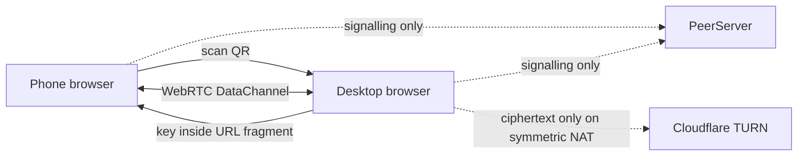

> **TL;DR:** **Engye** moves a file between two devices by showing a QR code on one and scanning it on the other. Bytes travel peer-to-peer over WebRTC and are encrypted in the browser with AES-256-GCM before they leave the device, so the signalling server and any TURN relay only ever see ciphertext. No accounts, no cloud upload, and a separate daemon mounts your phone as a network drive in Finder.

## What it is

Engye is a file transfer app by Pavel Safronov, the kind of thing that started as a weekend workaround and turned into a small product. It runs as a PWA at engye.fuzzyworld.net, with sideloaded Android apps, an iPhone app you build from source, and a desktop daemon that exposes your phone's storage over WebDAV.

The core interaction is small enough to explain in one line. Open Engye on the laptop, pick a file, a QR code appears. Scan it with the phone and the file arrives. Nothing in between. The author says the name is pronounced "an-jee", after the Ancient Greek word for a pledge or guarantee, which is either a nice detail or a warning depending on how your week is going.

Three modes cover the useful cases:

| Mode | Direction | What it does |
| --- | --- | --- |
| Broadcast | one to many | You show a QR, everyone who scans gets the same file |
| Collect | many to one | Your QR stays live and people send you files, links, or text |
| Engye Drive | two-way | A private channel between two devices, either side can push a file |

Collect is the one that changes how you run an event. The QR stays up for the whole session and arrivals land in a live feed with a timestamp, a name, and a sender, so a room of people can drop photos into your laptop without swapping email addresses. Broadcast is the mirror image: the file is encrypted once and served to every scanner, which is why a handout PDF works for a room of students.

## Getting the mount daemon running

The browser app alone covers ad-hoc transfers. The interesting piece is `engye-drive-mount`, a small Node daemon that bridges the phone into the desktop file manager.

```bash
npm install -g engye-drive-mount
engye-drive-mount
```

It listens on `http://127.0.0.1:47321` and does nothing on its own until the web app asks it to. Start the daemon, open Engye on the desktop, scan the QR with your phone, and a "Mount in Finder" toggle appears. Turn it on and the phone's storage shows up as a regular network volume you can browse, open, and save into.

Chrome and Edge detect the local daemon on their own. Firefox blocks it as mixed content, so Firefox users need the companion extension from addons.mozilla.org, which also adds a toolbar popup that scans the QR and mounts without opening a tab.

There are native apps for when a browser tab is the wrong shape:

- **Android**: a sideloaded APK that can be shared to from any other app through the system share sheet, plus a foreground service that keeps a Collect session alive while the phone is locked.
- **iPhone**: a native app with full session management and auto-reconnect. It is built and working, but the App Store submission was still in progress, so for now you clone the repo and run it in Xcode.
- **Firefox**: the extension described above, needed for the mount feature and nothing else.

## How the encryption works

The security design is the part of this project that was done carefully.

| Property | Detail |
| --- | --- |
| Encryption | AES-256-GCM, random IV per transfer |
| Key transport | URL fragment only, never sent in an HTTP request |
| File transport | WebRTC DataChannel, the signalling server sees only connection metadata |
| TURN relay | Relays ciphertext, never plaintext and never the key |
| Storage | None, the key and the plaintext live in browser memory |

The key is generated in the browser and encoded into the QR code's URL fragment, after the `#` symbol. Browsers never send a fragment to the server, so the signalling service cannot see it, a TURN relay cannot see it, and closing the tab destroys it permanently. The Web Crypto API needs a secure context, which the Cloudflare Pages deployment provides over HTTPS.

The connection itself is ordinary WebRTC. Two devices are introduced through a small signalling broker that only brokers the introduction and never touches file data. Engye runs its own PeerServer for that and falls back to the public `0.peerjs.com` when none is configured. After that, files flow directly between the two browsers.



On most home and office networks the transfer stays peer-to-peer over STUN. Symmetric NAT, the kind corporate networks usually have, needs a TURN relay. Engye fetches short-lived Cloudflare Calls TURN credentials on page load and falls back to the Open Relay community servers when Cloudflare is unavailable, showing a banner whenever the community relay is the one in use.

## Running your own relay

Because the project is AGPL and meant to be self-hosted, pointing it at your own TURN server is a matter of bookmarking a URL. The ICE server details ride along in the fragment.

```text
https://engye.fuzzyworld.net/#turnUrl=turn:yourserver.com:3478&turnUser=username&turnCred=password
```

Bookmark that URL and the app always uses your relay. The `turn:`, `turns:`, and `stun:` schemes all work, and the credentials are optional if your server does not want them. Hosting the whole app yourself takes two environment variables set on the Cloudflare Pages project, `TURN_KEY_ID` and `TURN_API_TOKEN`, which the credential function needs to mint the short-lived keys. Without them the app falls back to the community relay, which still works but is slower and tells you so in the interface.

Cloudflare's free tier covers a terabyte of TURN traffic a month, and the author asks for donations to cover whatever spills over. The community relay is the fallback that keeps things working when that runs out.

## Limits you will hit

Engye reads the whole file into memory before encrypting it, and the sender holds both the plaintext and the ciphertext at the same time. A 600 MB file needs roughly 1.2 GB of free memory, and once the ceiling is reached the tab crashes without a message.

| Mode | Suggested limit | Reason |
| --- | --- | --- |
| Engye Drive | about 500 MB | The full ciphertext stays in memory for the duration of the transfer |
| Engye | about 100 MB | The ciphertext is pre-encrypted once and held for the whole session |

The second limit is a deliberate trade. Encrypting once and reusing the ciphertext for every scanner is what makes a room of people scanning the same code cheap, and it also means the encrypted copy has to stay resident until the session ends. Moving to per-connection encryption would free that memory but cut concurrency.

Two more gaps sit on the author's own list. A dropped WebRTC connection cannot be resumed, so a transfer that fails at 90 percent starts over. Dropping a folder onto the window fails silently instead of showing an error. Both are planned, along with chunked encryption that would use the File System Access API to write received chunks straight to disk on Chrome and Edge.

## What to watch for

The license is AGPL-3.0-only, with a commercial license available to anyone embedding Engye in a closed-source product. For individuals, schools, and libraries that is a non-issue, and you can run your own signalling and TURN servers without paying anyone. The author is explicit that this is a side project rather than a venture-backed company, and that dual licensing exists to keep it free, not to fund it.

The repository moved off GitLab in October 2026 to `code.fuzzyworld.net` after GitLab's rate limiting blocked the author's access at work. The GitLab copy still exists but is frozen and no longer updated. The current home is a static site on Dreamhost with no accounts and no rate limits, while the web app deploys to Cloudflare Pages through a CI job. If you clone, clone from `code.fuzzyworld.net` and not from GitLab.

The public instance is a shared resource with an anonymous session model, so treat engye.fuzzyworld.net as the author's hosted copy rather than infrastructure you control. Self-hosting the web app is a `npm install` followed by a static build if you would rather have the whole thing under your own roof.
