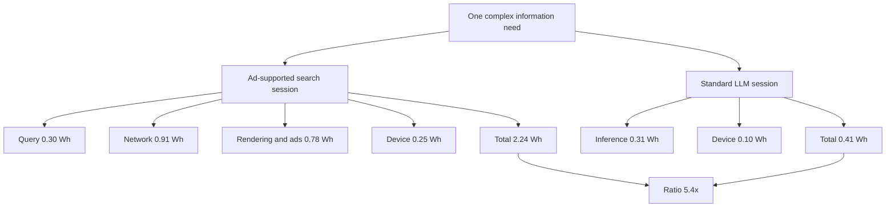

> **TL;DR:** Charles Duprat's working paper changes the unit of measurement in the AI energy debate from one server query to one whole user session. Shipped as a live interactive model with parameter sliders, Sankey diagrams and a 10,000-path Monte Carlo run, it finds that a mobile ad-supported search session costs roughly 5.4x the electricity of the equivalent LLM session. Every parameter is exposed and every revision is logged, so the numbers are yours to argue with.

## What it actually is

In 2023 a comparison spread widely across the internet: one LLM response used ten times the energy of a Google search query. It was technically narrow, comparing server-side GPU work for an unoptimised research deployment against a decade-mature search stack, but it stuck and shaped years of public debate.

Duprat's argument is that the comparison measured the wrong thing. A search engine does not hand you information, it hands you a map to information hosted somewhere else. The bill for following that map, covering page downloads, JavaScript rendering, ad auctions and reading time, is paid by your phone, your carrier and an ad-tech supply chain that never appears on the data centre meter.

So the functional unit changes. Instead of one query, the paper measures the complete user session needed to satisfy one complex information need, and names the framework a Comparative Energy Lifecycle Assessment, or CELCA. The author is careful about what that name does and does not claim: it is an attributional, screening-level comparison of final operational electricity, explicitly not an ISO 14040 conformant lifecycle assessment. Model training, search crawling and indexing, embodied carbon and end-of-life sit outside the model.

The paper is free to read on SSRN under DOI 10.2139/ssrn.6287918, first published 20 February 2026 and last revised 3 August 2026. The website is the more interesting artifact. It is a single-page interactive model where you can drag the page weight, network intensity, ad share and reading time and watch the ratio recompute live.

## Three scenarios, one headline number

| Scenario | Setup | Search session | LLM session | Ratio |
|---|---|---|---|---|
| A | Zero-click fact lookup on mobile | 0.36 to 0.39 Wh | 0.32 to 0.44 Wh | parity |
| B | Complex synthesis over 5G, three pages | 2.24 Wh | 0.41 Wh | 5.4x |
| C | Extended research on a laptop, five pages | 4.86 Wh | 1.29 Wh | 3.8x |

Scenario B is the headline, and the ledger behind it is short enough to check by hand. The search side breaks down into query processing at 0.30 Wh, network transfer at 0.91 Wh, page rendering at 0.60 Wh, an advertising increment of 0.18 Wh and six minutes of reading at 0.25 Wh. The LLM side is inference at 0.31 Wh, a network transfer of under 0.001 Wh for a 5 KB text payload, and 2.5 minutes of reading at 0.10 Wh. That gives 2.24 Wh against 0.41 Wh.



## The calculation is small enough to run yourself

The page ships the model as a handful of plain functions, and the unit arithmetic has a neat trick in it: multiplying megabytes by kWh per GB lands directly in watt-hours, because the megabyte-to-gigabyte divisor and the kilowatt-hour-to-watt-hour multiplier cancel out.

```javascript
const SCENARIO_B = {
  searchQueryWh: 0.3,
  pageWeightMB: 2.164,
  pages: 3,
  networkKWhPerGB: 0.14,
  renderWhPerPage: 0.2,
  adShareOfRender: 0.3,
  searchMinutes: 6,
  llmInferenceWh: 0.31,
  llmMinutes: 2.5,
  smartphonePowerW: 2.5
};

const deviceWh = (watts, minutes) => (watts * minutes) / 60;
const networkWh = (pages, pageWeightMB, kWhPerGB) => pages * pageWeightMB * kWhPerGB;

const searchTotal = (s) =>
  s.searchQueryWh +
  networkWh(s.pages, s.pageWeightMB, s.networkKWhPerGB) +
  s.pages * s.renderWhPerPage +
  s.pages * s.renderWhPerPage * s.adShareOfRender +
  deviceWh(s.smartphonePowerW, s.searchMinutes);

const llmTotal = (s) =>
  s.llmInferenceWh + deviceWh(s.smartphonePowerW, s.llmMinutes);

const ratio = searchTotal(SCENARIO_B) / llmTotal(SCENARIO_B);
```

The page also ships a Monte Carlo run that samples every parameter from its uncertainty range, which is the honest way to report a ratio built on estimates that point in the same direction.

```javascript
const uniform = (lo, hi) => lo + Math.random() * (hi - lo);
const ratios = [];

for (let i = 0; i < 10000; i++) {
  const p = {
    searchQueryWh: uniform(0.2, 0.5),
    pageWeightMB: uniform(1.769, 2.559),
    pages: Math.round(uniform(1.5, 5.5)),
    networkKWhPerGB: uniform(0.1, 0.17),
    renderWhPerPage: uniform(0.1, 0.45),
    adShareOfRender: uniform(0.15, 0.44),
    searchMinutes: uniform(5, 8),
    llmInferenceWh: uniform(0.16, 0.6),
    smartphonePowerW: uniform(2, 4)
  };
  p.llmMinutes = p.searchMinutes * uniform(0.4, 0.8);
  ratios.push(searchTotal(p) / llmTotal(p));
}
```

The inputs come from real sources. Inference energy uses the peer-reviewed 0.31 Wh median from Oviedo et al. in Joule, with a published interquartile range of 0.16 to 0.60 Wh. Google's production benchmark puts a median Gemini text prompt at 0.24 Wh, a 33-fold drop over twelve months. Page weights come from the HTTP Archive 2025 Web Almanac: 2.16 MB median mobile page, 2.56 MB for home pages and 1.77 MB for inner pages. Mobile network intensity uses a model-derived 0.14 kWh per GB, sitting between a 0.10 low-allocation case and Nokia's reported 0.17.

## Where the ratio stops holding

The specification set is the useful part, because it shows the direction of travel when each assumption moves.

| Variation | Search total | LLM total | Ratio |
|---|---|---|---|
| Central ledger | 2.239 Wh | 0.414 Wh | 5.4x |
| Inner-page payload at 1.769 MB | 2.073 Wh | 0.414 Wh | 5.0x |
| Home-page payload at 2.559 MB | 2.405 Wh | 0.414 Wh | 5.8x |
| Nokia network at 0.17 kWh per GB | 2.434 Wh | 0.414 Wh | 5.9x |
| Low-allocation network at 0.10 kWh per GB | 1.979 Wh | 0.414 Wh | 4.8x |
| Adjusted query at 0.0424 Wh | 1.981 Wh | 0.414 Wh | 4.8x |
| RTB-inclusive with 0.30 Wh overhead | 2.539 Wh | 0.414 Wh | 6.1x |
| No render or ad increments | 1.459 Wh | 0.414 Wh | 3.5x |
| Adverse inference at 0.60 Wh | 2.239 Wh | 0.704 Wh | 3.2x |
| Wi-Fi plus inclusive client term | 0.589 Wh | 0.414 Wh | 1.4x |

Three caveats deserve your attention. First, the accounting is attributional, not consequential. The model allocates shares of current operating electricity, it does not estimate what would physically appear on the grid if a session disappeared, so the differences are attributed operational electricity rather than demonstrated grid savings.

Second, reasoning models are out of scope and would change the picture. The paper estimates 1.0 to 5.0 Wh per query for leading reasoning configurations, roughly 3 to 16x the standard inference reference used in Scenario B. For agentic workflows with retrieval and repeated model calls the ratio can narrow or reverse.

Third, search itself is quietly becoming search plus LLM inference. Google AI Overviews synthesise answers using a model on top of the traditional query, which means the old 0.3 Wh canonical figure understates modern search. The paper also notes that roughly 69 percent of Google searches end without a click, and for those the two modalities land at parity. The advantage lives in the minority of queries that require visiting pages.

Server-side ad-tech energy is deliberately kept out of the central ledger and reported as its own specification. Using the Ad Net Zero framework's published defaults, a standard ad-supported page with 3 to 5 slots generates roughly 0.05 to 0.12 Wh of bidding energy, which is what pushes the ratio from 5.4x to 6.1x when included.

## Trying the model yourself

The site works with no build step and no account. Six sliders drive the calculation: inference energy, network intensity, page size, pages visited, ad share of rendering and search duration. A button runs 10,000 Monte Carlo paths and draws the resulting distribution, and the Sankey diagram above it redraws per scenario so you can see where each watt-hour lands.

Two details make it feel like a real research artifact rather than a marketing page. Every revision is logged in a changelog, currently at V1.5, and the V1.5 entry explains what changed, down to correcting the Web Almanac page-weight attribution and replacing a single headline range with seven named deterministic specifications. And the whole thing is bilingual, with a French edition at a separate path.

The paper is CC BY 4.0 and downloadable as a PDF from the same page.

## Source and Accuracy Notes

- Project page: https://dupr.at/thermodynamic-efficiency-inversion, verified via direct visit
- Working paper: DOI 10.2139/ssrn.6287918 on SSRN, first published 20 February 2026, last revised 3 August 2026
- Author: Charles Duprat, ORCID 0000-0002-2734-4108
- License: CC BY 4.0, stated in the page footer
- HN launch thread: "Show HN: LLMs consume 5.4x less mobile energy than ad-supported web search", 19 points at time of writing
- Primary sources behind the ledger: Elsworth et al. (2025) on Gemini inference, Oviedo et al. (2026) in Joule, HTTP Archive 2025 Web Almanac, Nokia mobile network intensity, Spatharioti et al. (CHI 2025) on task completion
